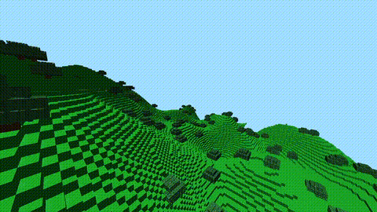
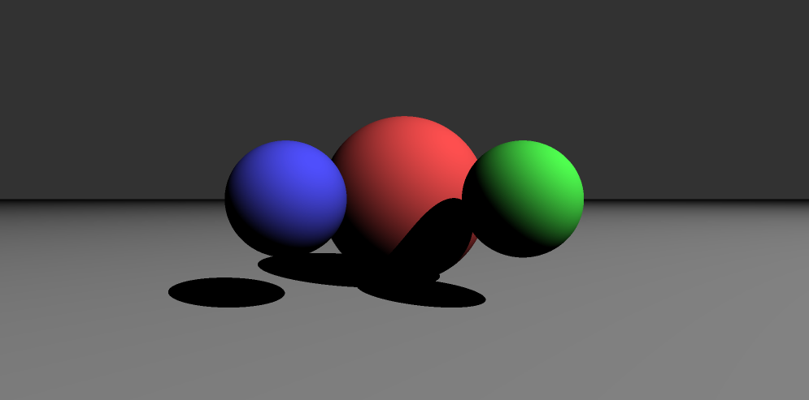
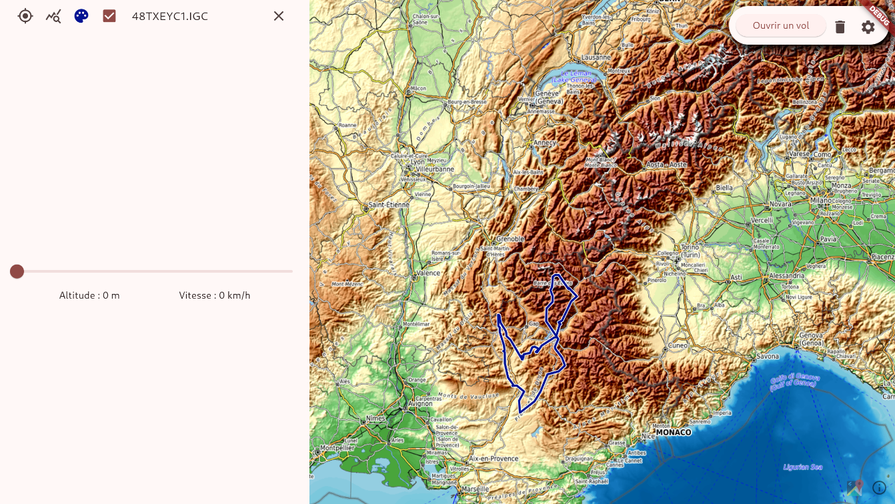
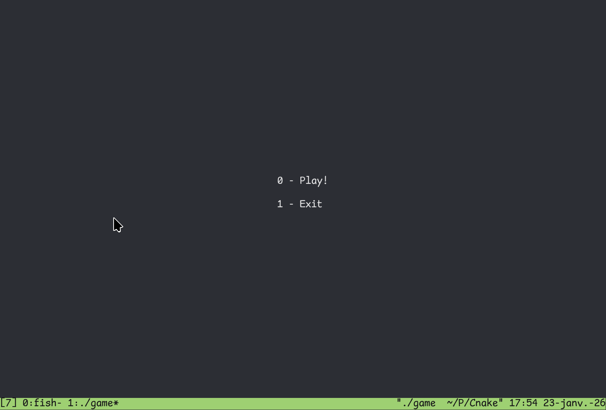
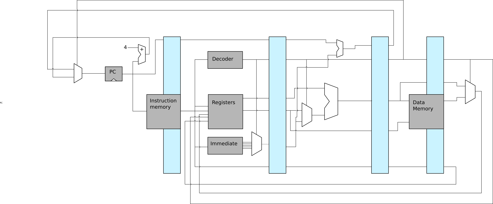

### Hi there 👋
I'm Hugo Berthet-Rambaud, an Engineering computer science student at INSA Lyon.

You will find here my trials and errors, solutions to various problems. There is also some fun stuff (like [Cnake](https://github.com/hugo-b-r/Cnake)) ! When I have a new idea, or learn something that could be useful, I try to apply it to these projecs !
I am currently building a voxel like or Minecraft Like game and learning a lot of stuff ! 

<table width="100%">
  <thead>
    <tr>
      <th width="50%"> <a href="https://github.com/hugo-b-r/LearnOpengl">Minecraft Clone</a> </th>
      <th width="50%"> <a href="https://github.com/hugo-b-r/Raytracer">RaytraCer</a> </th>
    </tr>
  </thead>
  <tbody>
    <tr>
      <td width="50%"> </td>
      <td width="50%"> </td>
    </tr>
  </tbody>
  <thead>
    <tr>
      <th width="50%"> <a href="https://github.com/hugo-b-r/Gliss">Gliss</a> </th>
      <th width="50%"> <a href="https://github.com/hugo-b-r/Cnake">Cnake</a> </th>
    </tr>
  </thead>
  <tbody>
    <tr>
      <td width="50%"> </td>
      <td width="50%"> </td>
    </tr>
  </tbody>
  thead>
    <tr>
      <th width="50%"> <a href="https://github.com/hugo-b-r/RISCV-FiveStage">RISCV-FiveStage</a> </th>
    </tr>
  </thead>
  <tbody>
    <tr>
      <td width="50%"> </td>
    </tr>
  </tbody>
</table>
